<picture>
  <source media="(prefers-color-scheme: dark)" srcset="static/brand/logo-dark.svg" />
  <source media="(prefers-color-scheme: light)" srcset="static/brand/logo-light.svg" />
  
</picture>

# Linkrovia

**Self-hosted short links, smart redirects, and analytics on Cloudflare.**

Use your own domain, route visitors to the right destination, and see how each link performs. A Cloudflare Worker serves the admin dashboard, handles redirects, and runs scheduled analytics jobs.

[Latest release](https://github.com/enjoydarts/linkrovia/releases/latest) · [Changelog](CHANGELOG.md) · [Deployment guide](docs/deployment.md)

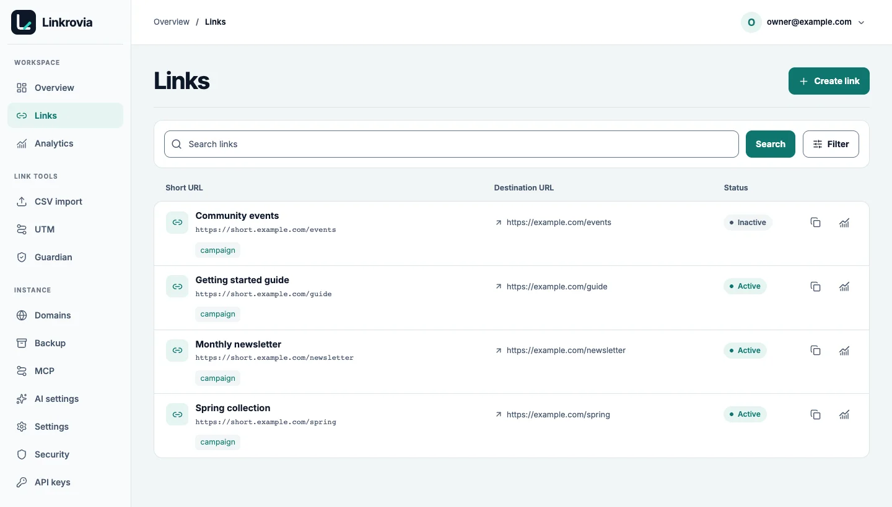

## Get started

1. Select **Deploy to Cloudflare**. Follow the prompts to connect GitHub, create a D1 database, and save a private random `SETUP_TOKEN` of 32–512 characters. [Deployment guide](docs/deployment.md)
2. Open the published Worker address or the setup link in the build log. Enter your token, choose your management hostname, then register your owner passkey. You can use `workers.dev` or connect your own hostname from setup. [Domain guide](docs/domains.md)
3. Create a link and test it in another tab. Once Analytics Engine is enabled, open **Link analytics** on that link to see its report. If Cloudflare deferred analytics during deployment, you can [enable it later](docs/deployment.md#enable-click-analytics) on the same installation.

## Tour the workspace

Screenshots show the current `main` branch with example data. Select a thumbnail to open it at full size. [Unreleased changes](CHANGELOG.md#unreleased)

### Set up your domain and sign in with a passkey

Choose your management hostname in the setup wizard. After setup, use **Domains** to assign additional short-link hostnames from the admin dashboard. [Domain guide](docs/domains.md)

<a href="docs/screenshots/setup.webp">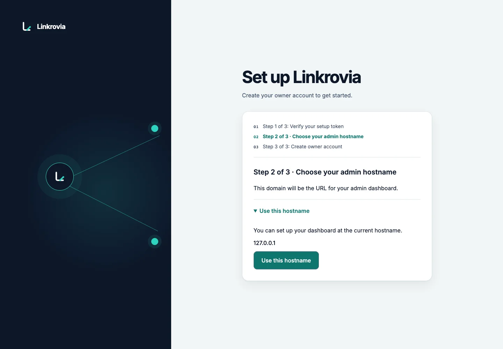</a>
<a href="docs/screenshots/domains.webp">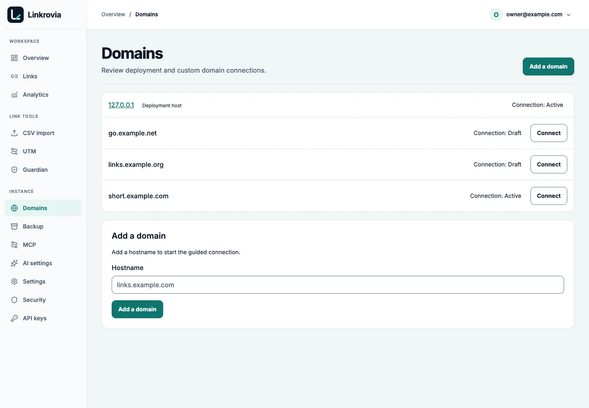</a>

### Create a short link and route visitors

Paste a destination to create a link with an automatic or custom slug. On a saved link, add **Redirect rules** for device, operating system, country, region, or language. Test them in the simulator, apply UTM templates, and share the link as a QR code. Links can also have a schedule, a password, or a single redemption.

<a href="docs/screenshots/create-link.webp">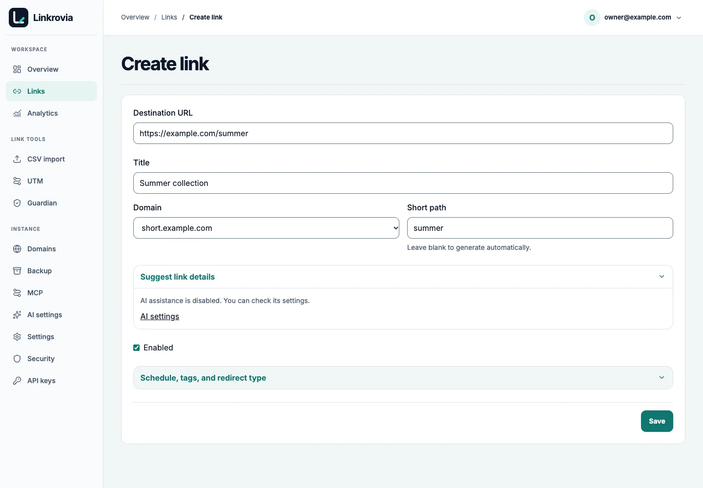</a>
<a href="docs/screenshots/redirect-rules.webp">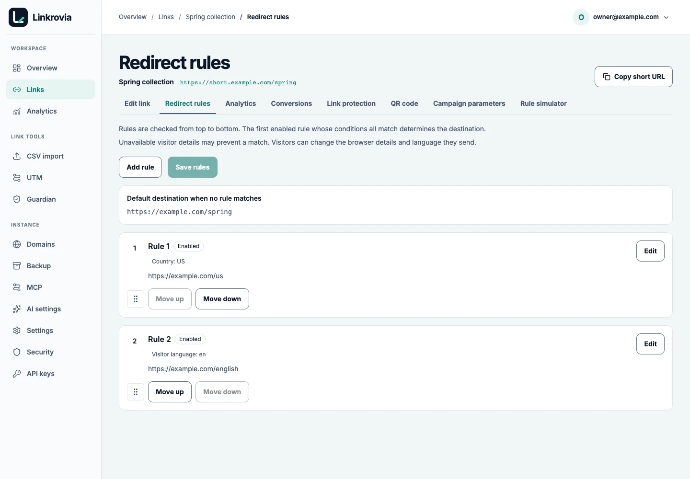</a>

### See how each link performs

Explore click trends and traffic breakdowns across your instance or for an individual link. Export CSV reports, define shared conversion goals, and submit events from your server. **Insights** compares two completed weeks and highlights changes. [Analytics and conversions](docs/analytics.md)

<a href="docs/screenshots/analytics.webp">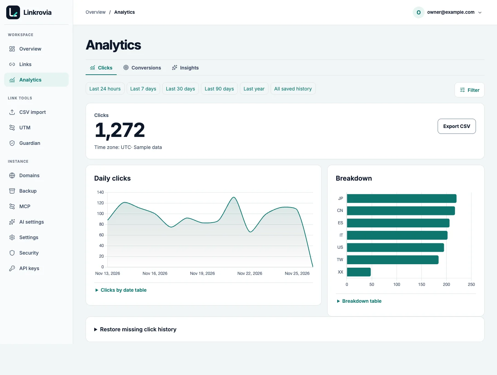</a>
<a href="docs/screenshots/per-link-analytics.webp">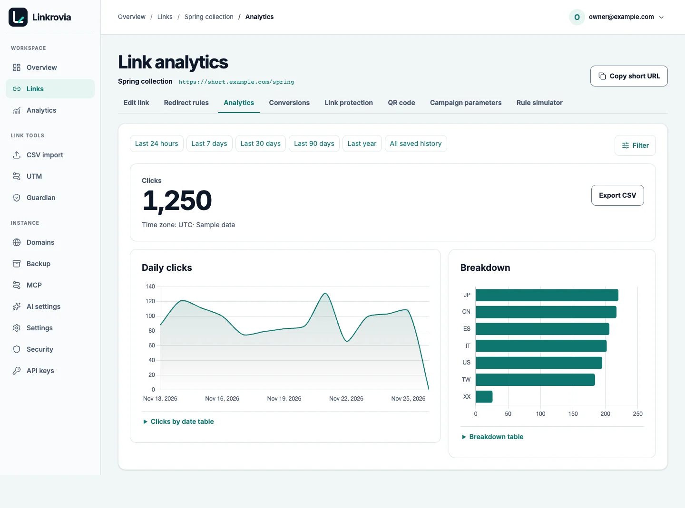</a>

### Review link health and opt in to AI assistance

**Guardian** checks saved redirect chains and public DNS. [Guardian and weekly reports](docs/analytics.md#weekly-reports-and-guardian)

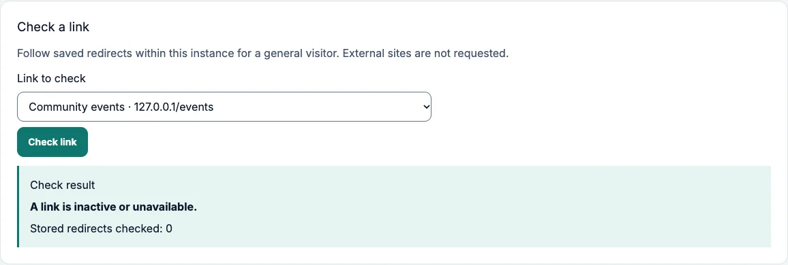

In **AI settings**, owners can opt in to budget-capped Workers AI for link suggestions, Insights reports, and optional weekly reports. The cost chart shows model usage estimates before Cloudflare’s account-wide free allocation. [AI setup](docs/analytics.md#enable-ai-assistance)

**Generate suggestions** uses the destination address. With the optional private metadata service connected, that action also reads the destination page’s Open Graph title and description. The companion service requires Workers Paid. [Metadata setup](docs/analytics.md#retrieve-page-information-automatically)

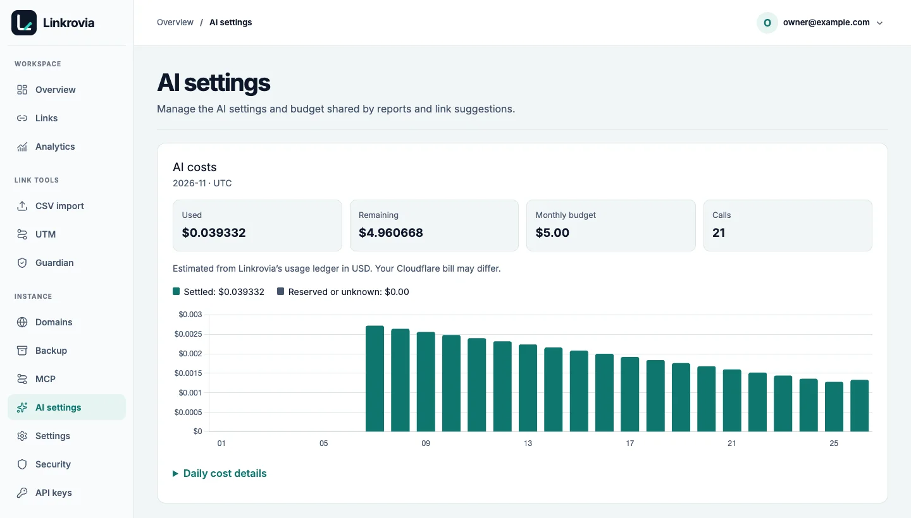

### Connect tools and manage your instance

Use scoped API keys for REST and MCP, with setup examples for Codex, Claude Code, GitHub Copilot, VS Code, Cursor, and Gemini CLI. Import links from CSV, export portable configuration backups, or invite administrators to help manage links. [MCP setup](docs/mcp.md) · [Operations](docs/operations.md)

<a href="docs/screenshots/dashboard.webp">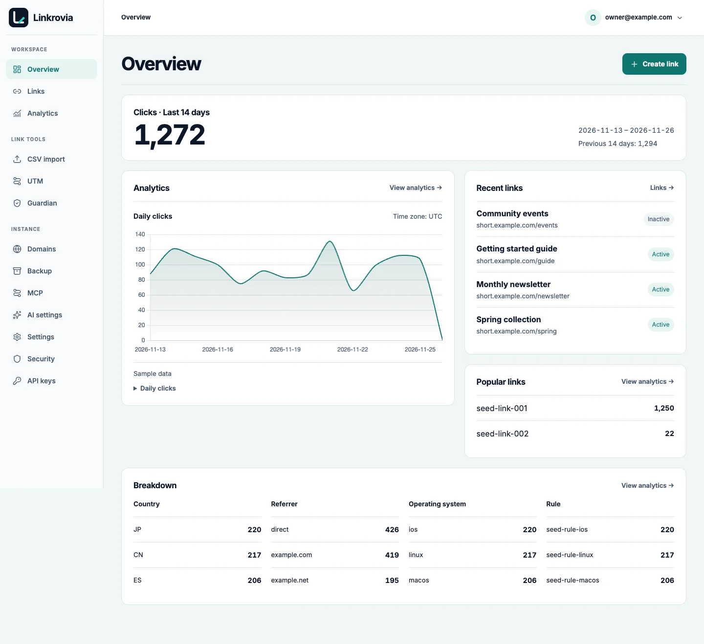</a>
<a href="docs/screenshots/integrations.webp">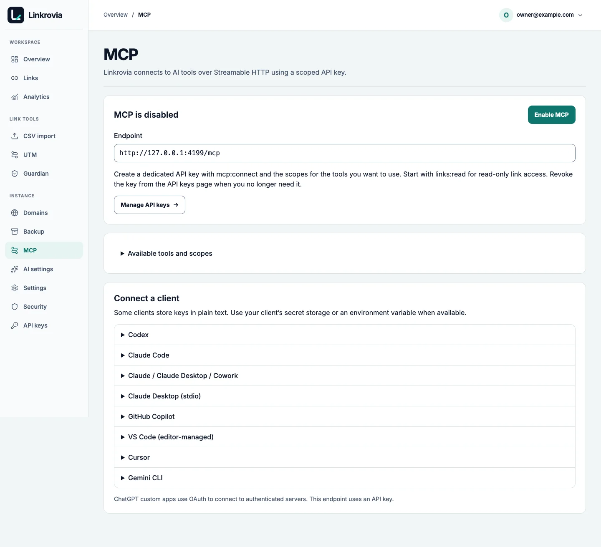</a>

The dashboard supports English, Japanese, Simplified Chinese, Traditional Chinese, Spanish, Italian, French, German, Korean, and Portuguese, with light and dark themes and user-selectable time zones.

## Documentation

| Task                                        | Guide                                                                                         |
| ------------------------------------------- | --------------------------------------------------------------------------------------------- |
| Install, connect hostnames, and upgrade     | [Deployment](docs/deployment.md) · [Domains](docs/domains.md) · [Upgrades](docs/upgrading.md) |
| Explore reports and set up conversion goals | [Analytics and conversions](docs/analytics.md)                                                |
| Administer and back up an instance          | [Operations](docs/operations.md) · [Backup and restore](docs/backup.md)                       |
| Integrate with REST or MCP                  | [OpenAPI 3.1 contract](static/openapi.yaml) · [MCP client setup](docs/mcp.md)                 |
| Run locally, test, and translate            | [Development](docs/development.md) · [Translation](docs/translation.md)                       |

## Project and branding

The Linkrovia project website is [linkrovia.com](https://linkrovia.com). Each installation uses its own configured hostnames and can customize the app name, logos, favicon, and primary color. [Brand guide](docs/BRAND.md)

## License

Linkrovia is released under the [MIT License](LICENSE).
